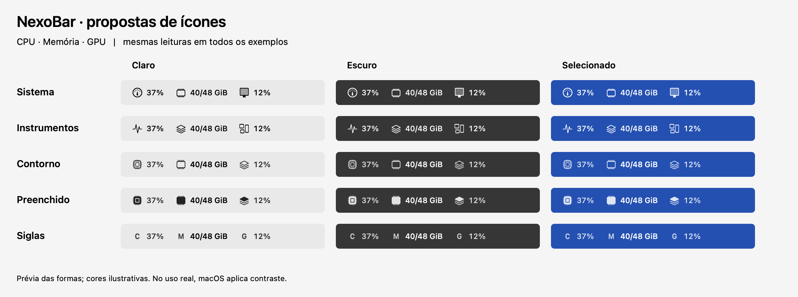

# Ícones nativos da barra

As duas novas famílias usam SF Symbols do macOS, com peso regular e desenho compacto. A preferência salva é mantida, inclusive **Siglas**; a mudança só ocorre ao escolher uma opção em **Personalizar barra → Ícones da barra**.

| Família | CPU | Memória | GPU | Leitura visual |
|---|---|---|---|---|
| Sistema | `gauge.medium` | `memorychip` | `display` | Medidor, chip de RAM e tela; proposta discreta para a barra do Mac. |
| Instrumentos | `waveform.path.ecg` | `square.stack.3d.up` | `rectangle.3.group` | Pulso de atividade, camadas e unidades gráficas; alternativa mais expressiva. |

CPU/GPU mantêm a temperatura agrupada ao valor. Os nomes de símbolos têm alternativas consultadas em sequência quando o sistema não oferece o primeiro. Os testes verificam a disponibilidade do símbolo principal no SDK/SO da máquina de validação.

O comparativo usa as mesmas leituras fictícias por componente (CPU, memória, GPU). As formas são as máscaras reais renderizadas pelo AppKit a partir de SF Symbols; a composição aplica preto no claro, branco no escuro e branco sobre azul no selecionado. Essas cores são ilustrativas e também são aplicadas aos estilos anteriores para comparar suas formas. Não é uma captura de botão ativo ou wallpaper: **prévia das formas; cores ilustrativas. No uso real, macOS aplica contraste.**

## Cor e seleção

**Sistema** e **Instrumentos** fazem a faixa inteira — ícones, valores, marcas de IA e ponto de atividade — virar uma imagem template (`NSImage.isTemplate = true`). O botão nativo da barra aplica a cor apropriada, inclusive quando o wallpaper faz a barra usar uma aparência diferente do tema geral. O raster contém somente uma máscara preta com transparência, sem fundo de seleção desenhado pelo aplicativo. A imagem normal e a alternativa usam a mesma máscara; a seleção fica a cargo do AppKit.

Esses dois estilos são monocromáticos: percentuais altos e pontos de atividade não recebem vermelho/laranja/azul na barra. Os números, a leitura antiga atenuada, as descrições de atividade e os detalhes permanecem disponíveis. **Contorno**, **Preenchido** e **Siglas** continuam em **Anteriores**, com seu comportamento de cores preservado.

O desenho continua fora da barra. Nenhum controle filho é acrescentado ao `NSStatusBarButton`; o mapa de posições mantém os cliques de cada componente.

Na personalização, a prévia também mantém o canvas fora da janela: um `NSImageView` exibe a imagem renderizada com `contentTintColor = .labelColor`. Assim, as novas famílias recebem a tinta clara/escura da janela, sem desenhar a máscara preta diretamente sobre o fundo. Mudanças de aparência regeneram a imagem e preservam seu tamanho.

## Reproduzir a comparação

Com Swift 6, macOS 14+ e o ambiente de compilação do projeto, execute a suíte `NativeSymbolStyleTests` com a variável de ambiente `NEXOBAR_ICON_PREVIEW_DIR` apontando para `docs/images` (caminho absoluto). Sem essa variável, o teste não grava arquivos. A suíte cobre compatibilidade de preferências, disponibilidade de símbolos, máscara monocromática em claro/escuro/selecionado, transparência da margem, overflow, barra vazia e retorno aos estilos anteriores. Ao exportar, também verifica contraste maior que 4,5:1 nos pixels opacos das três composições. A suíte existente `NativeStatusImageTests` cobre o roteamento do clique no botão nativo.
